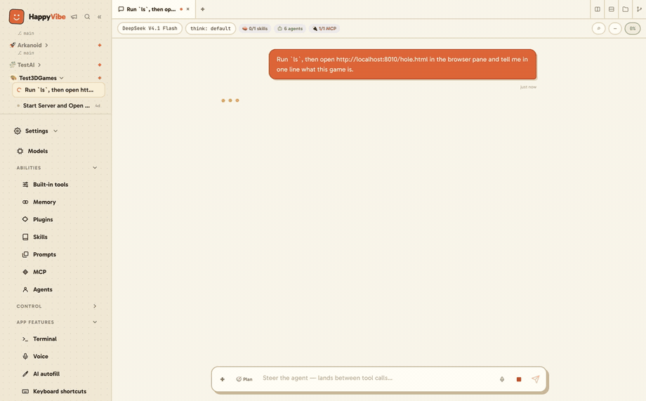

<p align="center">
  
</p>

<h1 align="center">HappyVibe</h1>

<p align="center"><b>Good vibes, real code.</b></p>

<p align="center">
  The ease of Claude Desktop and Codex — open source, on any model, and nothing it carries or
  sends that you can't see or switch off.
</p>

<p align="center">
  <a href="https://happyvibe.dev"><b>Website</b></a> ·
  <a href="https://happyvibe.dev/docs/"><b>Docs</b></a> ·
  <a href="https://github.com/guiguito/HappyVibe/releases/latest"><b>Download</b></a> ·
  <a href="CHANGELOG.md"><b>Changelog</b></a>
</p>

<p align="center">
  <a href="https://happyvibe.dev">
    
  </a>
</p>

---

HappyVibe is a desktop app for coding with AI that's meant to feel good to sit in front of.
Everything is already set up — terminals, a browser, documents, git, sub-agents, schedules — so you
open it and start. You follow what the agent does in plain language, and nothing happens behind
your back. That's what lets you relax and enjoy it.

> **Status:** pre-1.0 and moving fast. macOS, Windows and Linux.

## Why HappyVibe

**Everything is set up.** A browser the agent can read and click, terminals it can drive, documents
read on your computer, git, memory, schedules and sub-agents are wired and ready. No plugins to hunt
down, no config file to write.

**Any model — even fully offline.** Sign in with the plan you already pay for, bring an API key, or
run a local model with Ollama, LM Studio or llama.cpp, detected for you. Pick a small local model
and the agent starts on the basics, so it still fits.

**You see and shape what the agent carries.** Every built-in tool shows what it costs the model in
tokens, and every one switches off. The system prompt is a page you can read. The context gauge
shows what fills the window, and the cost ledger lists every call, including the ones the app makes
for you.

**Nothing happens behind your back.** The agent asks before anything risky, in plain words — and
**the approval dialog is written by the app, never by the model**, so a confused or manipulated
model can't talk you into a different action than the one that runs. Nothing loads itself: no
skill, extension or prompt template enters a session until you approve that specific one. Every
connection the app makes on its own has a switch.

## What's in the box

| | | Docs |
|---|---|---|
| **Work** | Streaming chat with tool cards and real diffs · file tree and editor · terminals · a built-in browser · documents (PDF, Office) · image generation (with OpenRouter) · voice dictation on your computer | [Session view](https://happyvibe.dev/docs/session-view/) · [Terminal](https://happyvibe.dev/docs/terminal/) · [Voice](https://happyvibe.dev/docs/voice/) |
| **Git** | Save a version · Sync · Undo on top, real git underneath, every command shown · worktrees · a pull request written up for you, created only when you press Create | [Files and changes](https://happyvibe.dev/docs/files-and-changes/) |
| **Delegate** | Plan mode · sub-agents · schedules that run on their own · memory across sessions · the agent asks you when it's unsure | [Schedules](https://happyvibe.dev/docs/schedules/) · [Memory](https://happyvibe.dev/docs/memory/) · [Agents](https://happyvibe.dev/docs/agents/) |
| **Extend** | A plugin store · MCP servers with in-app sign-in · skills · prompts — each approved one by one | [Plugins](https://happyvibe.dev/docs/plugins/) · [MCP](https://happyvibe.dev/docs/mcp/) · [Skills](https://happyvibe.dev/docs/skills/) · [Prompts](https://happyvibe.dev/docs/prompts/) |
| **See** | Context gauge · cost ledger · audit log of every permission decision · usage stats · the system prompt | [Stats](https://happyvibe.dev/docs/stats/) · [Audit log](https://happyvibe.dev/docs/audit-log/) · [System prompt](https://happyvibe.dev/docs/system-prompt/) |
| **Control** | Permission rules · a switch and a token cost on every built-in tool · privacy switches · rewind, fork and duplicate a session | [Permissions](https://happyvibe.dev/docs/permissions/) · [Built-in tools](https://happyvibe.dev/docs/built-in-tools/) · [Privacy](https://happyvibe.dev/docs/privacy/) |

## Install

**[Download the latest release](https://github.com/guiguito/HappyVibe/releases/latest)** — the app
updates itself after that. Step by step, with pictures: **[Install](https://happyvibe.dev/docs/install/)**.

- **macOS** (Apple silicon): open the `.dmg` and drag HappyVibe to Applications. It opens like any
  other app, with no warning.
- **Windows** (x64): run the `Setup.exe`. It installs for you only, with no admin prompt. The first
  time, SmartScreen shows a warning: choose **More info → Run anyway** — two extra clicks, on the
  first run only.
- **Linux** (x64): the `.deb` installs cleanly on Ubuntu and Debian; download each new version from
  the same page. The `.AppImage` runs anywhere and updates itself, but needs `libfuse2`, which
  Ubuntu 22.04 and later don't ship (`sudo apt install libfuse2`) — without it a double-click
  does nothing.

## Your first session

The app walks you through it the first time:

1. **Connect a model** — sign in, paste a key, or let it find a local model.
   → [Connect a model](https://happyvibe.dev/docs/connect-a-model/)
2. **Pick a project** — any folder on your computer.
3. **Personalize** — choose which tools the agent gets. Each one shows what it costs; untick
   anything you don't need. → [First launch](https://happyvibe.dev/docs/first-launch/)
4. **Ask for something.** The agent works, shows each step, and asks before anything risky.
   → [Your first session](https://happyvibe.dev/docs/first-session/)

## Privacy and running offline

Your keys and sign-ins stay on your computer; API keys are encrypted by the operating system.
Your conversations go to the model you picked. **Everything the app sends on its own has a
switch**: usage statistics, crash reports, feedback, remote settings and the model list on
**Settings → Privacy**, the update check on **Changelog**. An administrator can lock all of it off
before the first launch.

**One thing goes through us by default:** the agent's web search and page reading use HappyVibe's
free web service. Point it at your own Firecrawl-compatible service, or switch web tools off, on
**Built-in tools**.

With a local model, web tools on your own service or off, and those switches off, HappyVibe works
with no internet connection. Details: **[Privacy](https://happyvibe.dev/docs/privacy/)**.

## Build from source

You need **Node.js 24** and git. On **Linux**, also `build-essential` and `python3`
(`sudo apt install -y build-essential python3`) to compile `node-pty` — for building only, never
for running. On **Windows**, install from Windows itself, not from WSL.

```bash
git clone https://github.com/guiguito/HappyVibe.git
cd HappyVibe
npm install
cd pi-runtime && npm ci && cd ..   # BOTH installs are required
npm run dev                          # the app, with hot reload
```

`pi-runtime/` is a separate, pinned tree holding the agent engine; a clone without its install
fails in confusing ways. Connect a model in the app's own **Models** page, as a user would.

```bash
npm run gate                         # typechecks, build and the test suite — no model calls, no key
npm run build:mac                    # or build:win / build:linux — an installer for your own machine
```

### Use it from a browser

The app can also serve itself to a browser tab, on the same machine or from a WSL distro to Chrome
on Windows:

```bash
HV_SERVE=8787 npm start              # builds, then serves instead of opening a window
```

It prints a link carrying an access token (in the part after `#`, which never leaves the browser).
Open it once: the page keeps the token for that address only, and nothing that acts is served
without it. It listens on `127.0.0.1` only; from another computer, use an SSH tunnel
(`ssh -L 8787:127.0.0.1:8787 that-machine`) rather than `HV_SERVE_HOST`, which serves plain HTTP.
`HV_SERVE_TOKEN` keeps the same link across restarts.

Each browser tab is a window of the app. Closing the tab doesn't close the window: it waits, with
its terminals still running, and the next tab you open picks it back up. What a page can't do: show
the built-in browser (the agent still uses it), drag a tab out into a new window, or take ⌘W/Ctrl+W,
⌘T and ⌘N from the browser. File and folder dialogs are the machine's own, so they open on the
computer running the app — with WSLg, on the Windows desktop. Quit the desktop app first if both
would use the same profile.

Before a pull request, read **[CONTRIBUTING.md](CONTRIBUTING.md)** (setup behind a proxy, the live
suite, signing your commits). Working with a coding agent on this repo? It reads
**[AGENTS.md](AGENTS.md)** by itself — the conventions and the traps; per-subsystem rules are in
`.claude/rules/`.

## How it's built

An Electron app driving a **pinned, vendored [Pi](https://pi.dev) coding agent** as a subprocess,
over its JSON-lines RPC protocol. Pi is never imported as a library: process isolation gives each
session crash isolation and lets idle sessions hibernate.

```
Electron renderer (React + TypeScript + Vite)   src/renderer/
   ↕ typed IPC (contextBridge, window.hv)        src/preload/
Electron main                                    src/main/
   ↕ stdio, Pi RPC
Pi subprocess, one per session (pinned)          pi-runtime/
   extensions/happyvibe-bridge.ts                the permission gate and the app's own tools
```

- **The bridge owns every approval.** Pi's own permission package only works in its terminal UI,
  so the gate, the audit log and every approval dialog are HappyVibe's.
- **Nothing is discovered automatically.** Pi starts with `--no-skills --no-extensions
  --no-prompt-templates --no-themes`; approved resources are passed back in one by one. A cloned
  repository can't plant a file that loads itself.
- **Pins move on purpose.** Versions live in [`pi-runtime/package.json`](pi-runtime/package.json);
  contract tests re-derive what the app depends on, so an upgrade that changes it fails the build
  instead of drifting. Measurements and wire formats are recorded in
  [`docs/validation/`](docs/validation/).

## Honest limitations

- **Windows shows a SmartScreen warning on the first run.** Two extra clicks, once. macOS opens
  with no warning.
- **x64 only on Windows and Linux.** On Windows, the voice and document engines publish no arm64
  build, so arm64 machines run the x64 installer under emulation. On Linux, arm64 is excluded only
  because nothing tests it yet.
- **On Linux, the file tree doesn't refresh on its own.** Linux has no recursive file watching, so a
  file created outside the app appears on the next refresh. macOS and Windows update live.
- **It is not a sandbox.** The approval gate runs inside the agent's process, and the agent's shell
  can reach the network. It asks before it acts; it isn't a security boundary.
- **Costs are estimates**, from the price table of the pinned agent version. When it can't price a
  call it says **unknown** rather than $0.00, and a partly priced call shows as a minimum, marked `+`.
- **Offline, file search may need a one-time download.** The agent downloads `rg` and `fd` on first
  use if your computer doesn't have them; with no connection, its file search fails until they're
  installed.

## Contributing

Issues and pull requests are welcome. [CONTRIBUTING.md](CONTRIBUTING.md) has the setup and the one
rule: sign your commits (`git commit -s`). Please read the
[Code of Conduct](CODE_OF_CONDUCT.md). Security reports go through [SECURITY.md](SECURITY.md),
never a public issue.

## Project docs

- **[happyvibe.dev/docs](https://happyvibe.dev/docs/)** — the user guide, every screen
- [`CHANGELOG.md`](CHANGELOG.md) — what changed in each version, in plain words
- [`docs/prd.md`](docs/prd.md) — the product spec, with every decision and why
- [`docs/validation/`](docs/validation/) — measurements, wire formats and negative results
- [`AGENTS.md`](AGENTS.md) — working notes for changing this repo safely, read by any coding agent

## Licence

**Apache-2.0** — see [`LICENSE`](LICENSE); third-party attributions are in [`NOTICE`](NOTICE).
Use it, fork it, ship it in something commercial. The name and the logo aren't covered (Apache-2.0
§6), so a fork needs its own.
